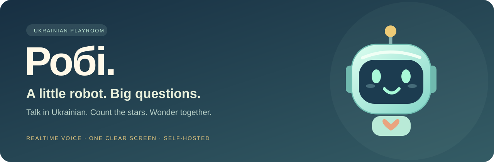
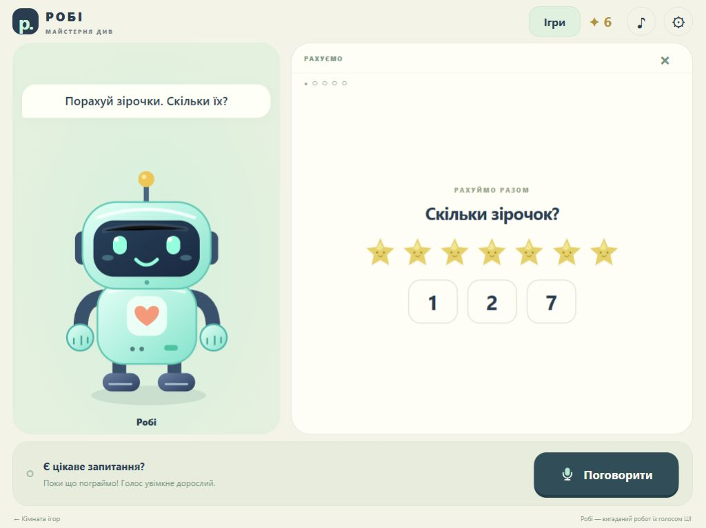
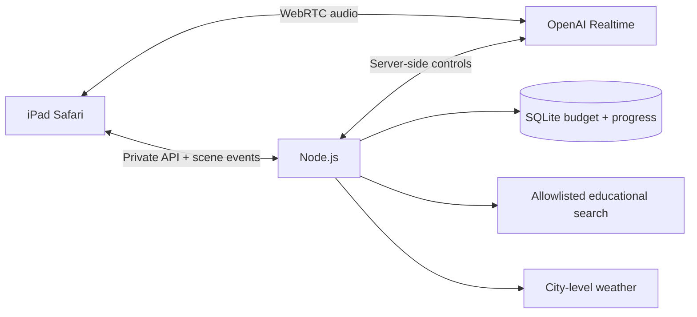

<p align="center">
  
</p>

<p align="center">
  <a href="https://github.com/i-xoxol/robi-playroom/actions/workflows/tests.yml"></a>
  
  
  <a href="LICENSE"></a>
</p>

<p align="center">
  <strong>A Ukrainian-speaking robot playroom for curious young children.</strong><br>
  Hold the microphone. Ask a question. Explore one thing together.
</p>

<p align="center">
  <a href="https://i-xoxol.github.io/robi-playroom/">Project page</a> ·
  <a href="docs/getting-started.md">Run it yourself</a> ·
  <a href="docs/architecture.md">How it works</a>
</p>

Part of the **[Family Game Room](https://github.com/i-xoxol/family-game-room)**:
five browser games for little learners, with a
[screenshot gallery and playable static demos](https://i-xoxol.github.io/family-game-room/).
Robi keeps its voice backend and history in this repository; the collection pins
it as a Git submodule.

## Why I built this

I wanted a small, friendly robot that a young child could talk to in Ukrainian
on an older iPad. It needed clear turn-taking, simple educational games, and a
screen that made sense while the robot was speaking.

Робі keeps one activity in view. A question about the Moon can show the Moon;
a counting game shows the stars being counted. When the topic changes, the old
pictures disappear. A parent controls access, voice and spending.

> **Scope:** a self-hosted, supervised family prototype. This repository contains
> source, generated fixed narration, and deployment-neutral documentation. It
> provides no access to a running family service, API keys, child recordings,
> private configuration or family data. AI responses still require adult oversight.

## See the playroom

<p align="center">
  
  <br><sub>Actual local interface with a synthetic game question. No child's speech or personal data was used.</sub>
</p>

## What it does

| Capability | Experience |
|---|---|
| **Ukrainian conversation** | Realtime Mini by default, optional full Realtime 2.1 through parent settings. Non-Ukrainian requests get a gentle Ukrainian reminder. |
| **Walkie-talkie controls** | Hold to speak, or use a parent-selected tap mode. The microphone track is disabled between turns. |
| **A robot that reacts** | An animated SVG robot listens, thinks, speaks, points and celebrates. |
| **One clear screen** | Landscape layout follows Safari's available viewport. Portrait asks the player to rotate. Game choices appear only in the game menu. |
| **Three prepared games** | Counting to ten, colors and shapes, and simple riddles with matching Ukrainian narration. |
| **Pictures that match** | Six bounded illustrations selected for the current answer; old content clears on a new spoken question. |
| **Current educational facts** | Server-side web search restricted to selected educational publishers and public agencies. Sources are available in parent settings. |
| **Tomorrow's weather** | City-level Open-Meteo forecasts, with the same city, date and data on screen and in the spoken answer. |
| **Home Screen installation** | Safari Share → Add to Home Screen, with a recognizable robot icon and standalone launch. |
| **Parent controls** | Password, expiring parent access, model selection, budget, interests and progress erasure. |
| **Private family context** | Parent-managed names, relationships, school and home city. These are separate from learned memories. |
| **Memory between conversations** | Sol 6.1 at medium reasoning reviews transient child transcripts in the background. Useful notes persist; new people wait for parent review. |

## Try the prepared games without an API key

Install [Node.js](https://nodejs.org/) 22.13 or newer, then:

```bash
git clone https://github.com/i-xoxol/robi-playroom.git
cd robi-playroom
npm ci --ignore-scripts
cp .env.example .env.local
node scripts/password-hash.mjs
```

Paste the generated salted hash into `ROBOT_PASSWORD_HASH` in `.env.local`.
Leave the API key blank for the prepared games. Start the app:

```bash
node --env-file=.env.local server.mjs
```

Open **http://127.0.0.1:8093/games/robot-pal/**. On Windows, use
`Copy-Item .env.example .env.local` for the copy step. The
[setup guide](docs/getting-started.md) covers paid conversation, the independent
parent/ZDR flags, HTTPS hosting and iPad installation.

## How it fits together



Plain HTML, CSS and JavaScript run the playroom. Node owns authentication,
tool execution and usage accounting. Permanent provider keys stay on the server.
The prepared games own their random question and exact narration, so a model
cannot narrate a different set of objects after starting one.

Read [the architecture guide](docs/architecture.md) for scene ownership,
security boundaries and the source map.

## Privacy, costs and practical limits

- No raw audio, full transcript, city lookup or search question is saved by this app.
  Authentication, usage totals, bounded progress, interests, parent facts and brief
  learned memories are stored locally. Memory-enabled voice adds asynchronous
  transcription and background review; parents can inspect, disable and erase
  learned memory. External providers process the requests sent to them.
- Parent authorization and provider Zero Data Retention approval are separate
  flags. Enabling one does not establish the other or change provider retention.
  Review current provider requirements before enabling children's voice.
- Live conversation and educational search use paid APIs, separately from a
  ChatGPT or Codex subscription. A configurable monthly app budget defaults to
  $20 and reserves for in-flight work; provider billing remains authoritative.
- Search filters, prompts and bounded tools reduce exposure. They do not
  guarantee correctness or suitability. Forecasts can change; Mini can make
  language mistakes. Use with an adult nearby.
- Internet access is required. Safari microphone access needs HTTPS. Physical
  iPad/Safari behavior should be verified on the target device; desktop viewport
  checks are not a substitute for device testing.
- Autonomous game generation through a Codex subscription is not implemented.
  The current scope is conversation, bounded illustrations and three prepared games.

## Development

```bash
npm run check
npm test
```

The regression suite covers authentication, Safari headers, CSRF, budget
reservations, cancelled responses, game narration ownership, query validation
and forecast handling. Tests use temporary databases and no provider calls.
Optional paid synthetic model checks are documented in the setup guide.

The public project page is a static overview under `docs/`. It does not connect
to a family instance or spend API credits. Source and original interface assets
are MIT-licensed; Open-Meteo data uses its own
[CC BY 4.0 attribution terms](https://open-meteo.com/en/terms).
