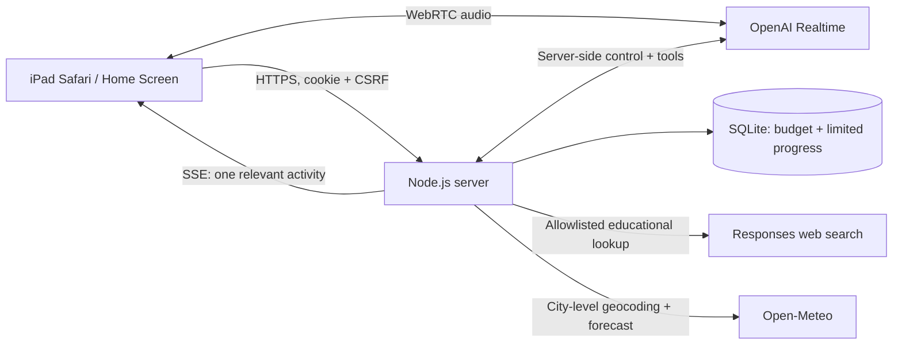

# How it works

## One screen, one topic

The conversation stage shows the robot and its current words. Game choices are
available through a deliberate menu; they do not remain next to explanations.
Starting a new spoken question clears the previous illustration or game.
`show_picture` can select one of six bounded illustrations. Unsupported topics
stay in the robot view rather than using a loosely related picture.

The browser chooses each prepared game's random question and plays its exact
matching fixed narration. After `start_game`, the server does not request a
model continuation that could invent a different question. Weather receives a
dedicated city/date/forecast card from the same structured data returned to the
voice model. Navigation interrupts existing speech. Cancelled answers cannot
restore an old illustration.

## Conversation and tools

The default model is `gpt-realtime-2.1-mini`; parents can select
`gpt-realtime-2.1`. Node creates the unified Realtime call and keeps the permanent
API key on the server. A server-side WebSocket handles tool execution and
settles usage. The browser exchanges audio through WebRTC and holds its local
microphone track disabled outside the explicit capture interval.

Tools are bounded: `start_game`, `show_picture`, `gesture`, `remember_interest`,
`look_up_fact`, and `get_weather`. There is no shell, general URL fetch, arbitrary
code execution, purchase tool, or autonomous game generation. Future game
authoring would need a separate adult-reviewed development workflow.

Search uses the Responses API's `web_search` domain filter. Sources are restricted
to educational/science publishers and public weather agencies, then filtered
again before returning citations. The search prompt treats pages as untrusted
data. Unsafe queries and obvious private details are rejected before a request.
Source links are available to the adult in parent settings.

Forecasts use fixed Open-Meteo endpoints. The tool accepts a city, optional
country/region, and today/tomorrow. Ambiguous cities require clarification.
Coordinates are city-level lookup intermediates, never the device's GPS, and
are not saved. Dates come from the location's forecast timezone. Missing data
produces a failure, not a made-up forecast. Open-Meteo weather data is attributed
under [CC BY 4.0](https://open-meteo.com/en/terms).

## Family context and memory

An optional private `ROBOT_FAMILY_PROFILE` JSON file seeds a new database once.
Supported fields are `childName`, `city`, `region`, `country` (two-letter code),
`school`, `grade`, `teacher`, `father`, `mother`, `grandmother`, `cat`, `sister`
and `sisterNote`. Keep it outside the repository and public assets. Parent settings
edit the database copy thereafter. Public source and screenshots must not include
a real family's profile. Parent facts take precedence over learned claims and
remain after a learning reset. Only unlocked parent routes expose the saved list.

When learned memory is enabled, Realtime input transcription uses `gpt-transcribe`
in Ukrainian. Its final child text stays briefly in RAM. It does not delay the
voice reply. Small batches go to `gpt-6.1-sol`, `reasoning.effort=medium`, with
`store:false`, strict JSON output and no tools. No assistant statements or adult
test turns feed memory. Batches are limited and spaced at least 20 seconds apart.
The supervisor is an organizer, not a real-time safety review of every reply.

Candidates need a matching source phrase, pass server-side text checks and fit
the 36-note cap. Preferences and learning notes are active; new people wait for
parent approval. Recent experiences expire after 30 days. Up to 24 active notes
enter subsequent voice context; parent names/relationships cannot be overwritten
by this workflow. The model and transcription can still make mistakes, so parents
can inspect or forget individual notes. Erasure and opt-out invalidate jobs
already running so they cannot restore erased data. Disabling learned memory
also stops the current call to remove its transcription configuration.

Supervisor tokens and duration-based transcription estimates count toward the
same monthly allowance. Provider billing is authoritative. No Codex subscription
quota is used by these server API calls. Parent facts and active memories are sent
to the conversation model; the supervisor receives the fixed profile and small
text batches. Search receives only a general educational question, and weather
uses city-level data. Provider retention is separate from local deletion.

## Authentication and spending

Family passwords use scrypt. Sessions use an expiring HttpOnly, Secure,
SameSite=Strict cookie in production. Mutations require same-origin checks and
authenticated CSRF tokens. The login path has a bounded Safari fallback for
missing/opaque Origin headers; it requires a custom AJAX header and JSON,
and cross-site requests are rejected. Public icon/manifest assets are explicitly
allowlisted. Game code, audio, and APIs require authentication.

SQLite tracks a configurable monthly app budget, default $20. Reservations guard
in-flight responses and are conservatively settled after uncertain failures.
Only one family conversation runs at once. Calls have age, idle and microphone
hold limits. The ledger is a local estimate; provider billing is authoritative.

## Data and limits

The app does not persist raw audio, transcripts, search questions or city
lookups. It saves authentication records, usage totals, bounded game progress
optional finite learning interests, parent facts and brief learned memories.
Parents can erase learning records and manage family context separately.
Provider processing and retention remain governed by that provider/account;
`store:false` and an app-side parent flag do not establish Zero Data Retention.

Language prompts and an output guard keep the Ukrainian robot role. Safety
prompts, bounded tools and domain restrictions reduce exposure; they cannot
guarantee every generated answer is appropriate or correct. Mini can produce
awkward Ukrainian. This is a supervised family prototype, not a certified
children's platform.

## Source map

An optional `READING_ROOT` can serve a separate prepared reading app at
`/games/robot-pal/reading/` using the family cookie. Its assets are separate from
this repository. That scope has no microphone access or external API connection
in its content security policy. Static audio supports Safari byte-range requests.

| Path | Purpose |
|---|---|
| `server.mjs` | Password/session handling, private assets, API and SSE |
| `lib/core.mjs` | SQLite, usage accounting, Ukrainian role and tool schemas |
| `lib/realtime.mjs` | Call lifecycle, sideband controls and search |
| `lib/weather.mjs` | Validated city-level forecasts |
| `lib/memory.mjs` | Private profile validation, bounded memory and background supervisor |
| `lib/request-security.mjs` | Same-origin and Safari request checks |
| `public/` | Plain HTML/CSS/JS, robot SVG, icons and fixed narration |
| `test/` | Local regression suite without provider requests |

Provider references: [Realtime WebRTC](https://developers.openai.com/api/docs/guides/realtime-webrtc),
[web search filters](https://developers.openai.com/api/docs/guides/tools-web-search#domain-filtering),
[Open-Meteo forecast](https://open-meteo.com/en/docs),
[geocoding](https://open-meteo.com/en/docs/geocoding-api).
